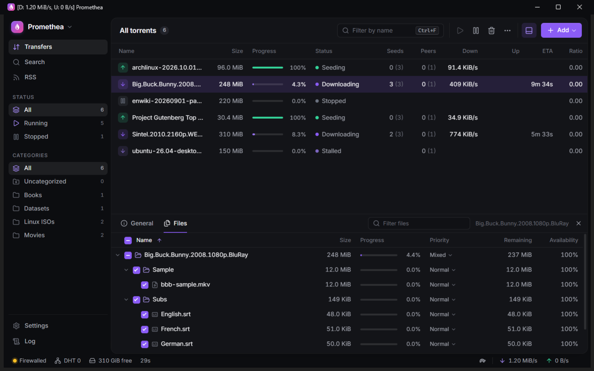
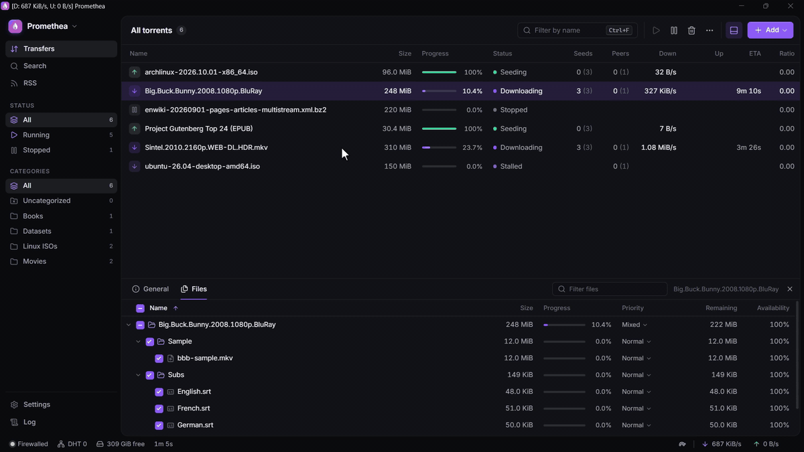

# Promethea

A fast, uncluttered BitTorrent client for Windows, built on libtorrent, with qBittorrent's feature
set. Named after Prometheus, who took fire from the gods and gave it to everyone.



- Simple by default: the sidebar shows what's running and what's stopped, and the details panel
  shows General and Files. Switch to Detailed in Settings, or right-click a sidebar heading or a
  details tab to choose exactly which filters, sections and tabs show
- Categories, tags, and filters by status and tracker
- Speed limits, plus an alternative-speed mode on a schedule
- Search through plugins: the ones made for qBittorrent work as they are
- RSS feeds with download rules
- A torrent creator
- Sequential download, file priorities, peer and tracker details, an IP filter
- A web UI to use it from your phone or another computer
- Light and dark themes, and it can keep running in the tray when you close the window



## Install

Download `Promethea-<version>-Setup.exe` from [Releases](../../releases) and run it. It installs
for your account only, so it doesn't ask for admin rights. It can set Promethea to open `.torrent`
files and magnet links.

The installer isn't code-signed yet, so Windows SmartScreen will say it "protected your PC".
Choose **More info → Run anyway**.

Promethea needs Windows 10 or 11 (64-bit) and the Microsoft Edge WebView2 Runtime, which Windows 11
always has. The installer tells you if it's missing.

## Run from source

Needs Python 3.12 and Node.js.

```powershell
uv venv --python 3.12 .venv
uv pip install --python .venv\Scripts\python.exe -e .   # the Python package, editable
cd ui; npm install; npm run build; cd ..                  # the React UI, built into promethea\web
.venv\Scripts\promethea.exe
```

- `--minimized` starts in the tray.
- `--headless --port 8080` runs without a window. The web UI is served on that port, so another
  device on your network can use it.
- `--data-dir <folder>` keeps settings and the session somewhere other than the default profile
  (`%APPDATA%\Promethea`).
- `python -m promethea` takes the same options.

Launching Promethea while it's already running brings the existing window forward. Torrent files and
magnet links that you open go to that window.

For the Vite dev server, run `npm run dev` in `ui`. `tools\make_icon.py` redraws the app icon from
the logo.

### If a console window opens with Promethea

uv 0.11 creates the venv's `pythonw.exe` as a copy of its console `python.exe`. `promethea.exe` runs
`pythonw.exe`, so you get a console window next to Promethea. Copy in the windowed launcher (redo this
after recreating the venv):

```powershell
Copy-Item "$env:APPDATA\uv\python\cpython-3.12-windows-x86_64-none\Lib\venv\scripts\nt\pythonw.exe" .venv\Scripts\pythonw.exe -Force
```

## Build the installer

Needs [Inno Setup 6](https://jrsoftware.org/isinfo.php) as well.

```powershell
uv pip install --python .venv\Scripts\python.exe -e ".[build]"
powershell -ExecutionPolicy Bypass -File packaging\build.ps1
```

This builds the UI, freezes the app with PyInstaller into `dist\Promethea`, and writes
`dist\Promethea-<version>-Setup.exe`.

## License

GPL-3.0-or-later. See [LICENSE](LICENSE). The installed app includes the licenses of the libraries
it bundles in `THIRD-PARTY-NOTICES.txt`.
